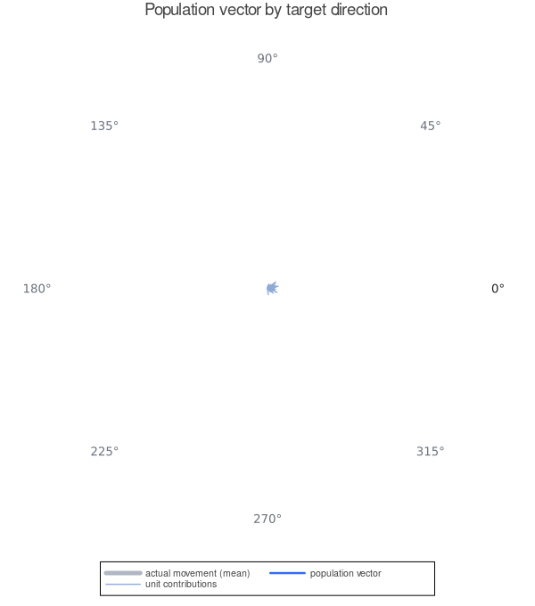
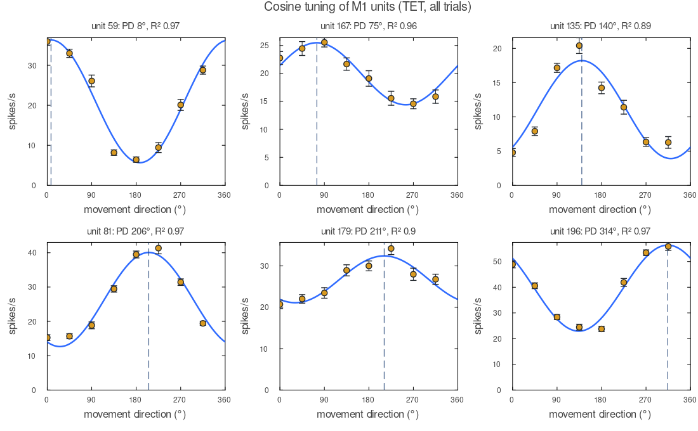
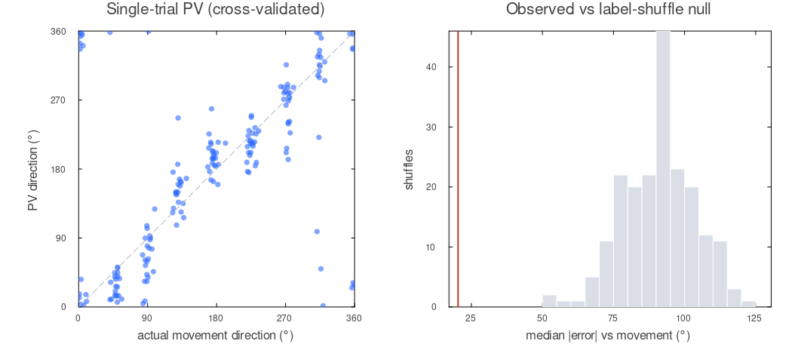
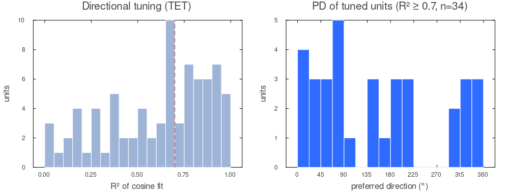
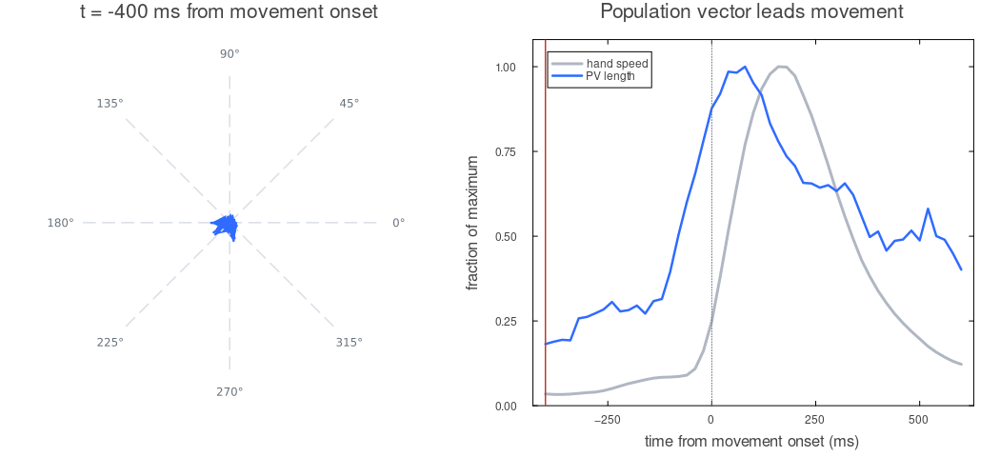
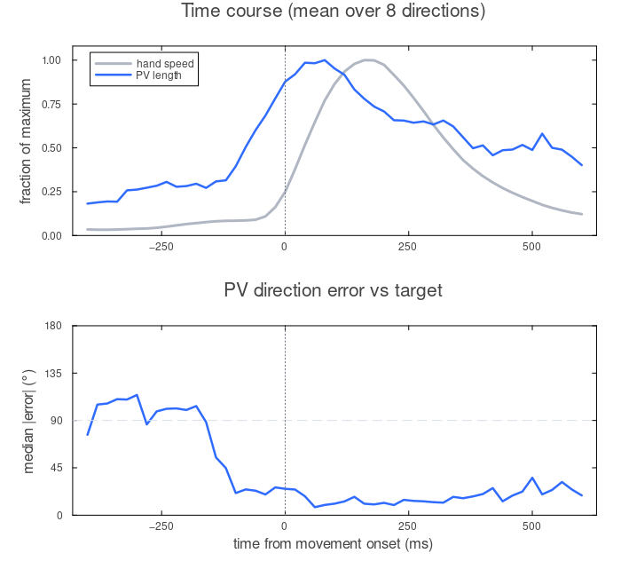

# M1 집단 벡터로 팔 뻗기 방향 디코딩

[English](README.md) · **한국어**

Flint et al. (2012)의 공개 center-out reaching 데이터에 Georgopoulos et al.
(1982, 1986)의 방향 튜닝과 집단 벡터(population vector) 디코딩을 적용한
공부용 프로젝트입니다. Julia로 작성했습니다.



각 목표 방향마다 가는 선은 튜닝된 unit들의 기여(가중치 × 선호 방향)입니다.
이를 더한 것이 집단 벡터(파란색)이고, 회색은 실제 운동 방향의 평균입니다.
집단 벡터는 학습에 쓰지 않은 trial로 계산했습니다.

## 데이터

Flint et al. (2012)의 데이터로, CRCNS의 DREAM 데이터베이스(Walker & Kording,
2013)에서 받을 수 있습니다: <https://crcns.org/data-sets/movements/dream>.

Flint 2012 데이터셋의 `Flint_2012_e1.mat`을 받아 `data/`에 넣으면 됩니다.
데이터 파일은 이 저장소에 포함되어 있지 않습니다.

- spike는 일차 운동 피질(M1) 팔 영역에 삽입한 96채널 피질 내 전극으로
  기록되었습니다. 원 논문에서 PMd는 경막외(epidural) 전위로만 기록되었고,
  여기서는 사용하지 않습니다.
- 8개 목표로 팔을 뻗는 center-out 과제입니다. trial 194개 중 175개가 `good`입니다.
- sort code 1–3인 unit 82개를 후보 unit으로 사용했습니다.

## 실행 방법

Julia 1.10 이상이 필요합니다.

```bash
julia --project=. -e 'using Pkg; Pkg.instantiate()'
julia --project=. scripts/01_single_unit_tuning.jl
julia --project=. scripts/02_population_vector.jl data/Flint_2012_e1.mat tet
julia --project=. scripts/02_population_vector.jl data/Flint_2012_e1.mat mt
julia --project=. scripts/03_time_resolved_pv.jl
julia --project=. -e 'using Pkg; Pkg.test()'
```

| 스크립트 | 하는 일 | 출력 |
| --- | --- | --- |
| `01_single_unit_tuning.jl` | unit 하나의 튜닝 곡선, raster, PSTH (기본값 unit 3) | `outputs/single_unit/` |
| `02_population_vector.jl` | 전체 unit 튜닝, 교차검증 집단 벡터, 셔플 검정, 애니메이션 | `outputs/population_vector/` |
| `03_time_resolved_pv.jl` | 운동 시작 전후 슬라이딩 구간의 집단 벡터 | `outputs/time_resolved/` |

## 방법

1. **이벤트.** 목표 제시 시점은 `TargetPos`에서 구합니다. 운동 시작과 끝은
   목표 방향으로의 손 속도가 5 샘플 연속 0.05 이상 / 미만이 되는 시점입니다.
   Georgopoulos et al.은 임계값 수치를 밝히지 않았으므로 이 값은 선택한 값입니다.
2. **발화율.** 구간 내 spike 수를 구간 길이로 나눈 값입니다. RT(목표 제시 →
   운동 시작), MT(운동 시작 → 끝), TET(목표 제시 → 운동 끝) 세 구간을 씁니다.
3. **튜닝.** 발화율을 목표 방향별로 평균한 뒤
   `y = b0 + b1 sin θ + b2 cos θ`로 피팅합니다.
   선호 방향 `PD = atan2(b1, b2)`, 진폭 `√(b1² + b2²)`.
4. **집단 벡터.** R² ≥ 0.7인 unit마다 자신의 PD 방향으로
   `(r − b0) / 진폭` 크기의 벡터를 더합니다.
   - 방향별 평균 집단 벡터: 시험 trial의 발화율을 방향별로 먼저 평균합니다
     (원래 방식).
   - 단일 trial 집단 벡터: 시험 trial 하나씩 따로 디코딩합니다.
5. **검증.** 방향별로 층화한 5겹 교차검증입니다. 튜닝 피팅과 unit 선택은 학습
   fold에서만 합니다. 디코딩한 방향을 목표 방향, 그리고 실제 손 변위 방향(운동
   시작 → 끝)과 비교합니다. 대조 모델로 학습 fold의 방향 라벨을 200번 섞었습니다.

## 결과

선호 방향이 고르게 퍼진 튜닝 unit 6개입니다. 발화율이 운동 방향의 코사인 함수로
잘 설명되고, unit마다 선호하는 방향이 다릅니다.



| 구간 | 집단 벡터 | 목표 방향과의 오차 (중앙값) | 실제 운동과의 오차 (중앙값) | 8방향 정답률 |
| --- | --- | --- | --- | --- |
| TET | 방향별 평균 | 11.9° | 14.9° | – |
| TET | 단일 trial | 16.8° | 20.3° | 58.9% |
| MT | 방향별 평균 | 10.8° | 11.5° | – |
| MT | 단일 trial | 14.8° | 15.8° | 66.3% |

- TET 기준 82개 중 34개 unit이 튜닝되어 있습니다(R² ≥ 0.7). 예를 들어 unit 3은
  PD 67.6°, R² 0.94입니다.
- 라벨을 섞으면 오차 중앙값이 약 90°, 8방향 정답률이 12.5%로 우연 수준입니다.
  실제 오차는 200번의 셔플 모두보다 작았습니다(p = 0.005, 200번 셔플로 얻을 수
  있는 최솟값).




### 시간에 따른 변화

운동 시작 전후로 100 ms 구간을 20 ms씩 옮겨 가며 집단 벡터를 계산할 수도
있습니다(튜닝은 학습 fold, 집단 벡터는 시험 trial로 계산하는 방식은 위와 같습니다).



- 집단 벡터는 손이 움직이기 **전에** 커집니다. 길이가 변화 폭의 절반에 이르는
  시점이 −60 ms이고, 손 속도는 +40 ms입니다. 약 100 ms 앞섭니다.
- 방향도 운동 시작 전에 이미 목표에 가깝습니다(오차 중앙값 −100 ms에서 21°,
  +200 ms에서 12°). 운동 시작 300 ms 전에는 목표와 관계없습니다(114°).
- 구간은 중심 기준이라, −60 ms 값은 −110 ~ −10 ms의 spike를 사용합니다.



### 한계

- 225°–315°를 선호하는 튜닝 unit이 적어서, 270°와 315° 목표의 집단 벡터가
  이웃 방향으로 기웁니다. PD가 고르게 분포하지 않을 때 집단 벡터가 갖는 알려진
  약점이며, optimal linear estimator(Salinas & Abbott, 1994)로 보정할 수 있습니다.
- 세션 하나(`e1`)만 분석했습니다.
- sort code 1–3을 정렬된 unit으로 간주했지만, 파일만으로 각각이 단일 뉴런이라고
  보장할 수는 없습니다.

## 코드 구성

```text
src/
  DREAMReach.jl          모듈 진입점
  session.jl             MAT 파일 로딩, trial·목표·spike 접근
  events.jl              목표 제시, 운동 시작과 끝 검출
  tuning.jl              구간 발화율, 코사인 피팅
  perievent.jl           운동 정렬 raster / PSTH 데이터
  population_vector.jl   교차검증 집단 벡터 (시간에 따른 계산 포함)
  plotting.jl            그림
scripts/                 분석 스크립트 (번호 순서대로 실행)
test/runtests.jl         데이터 구조, 이벤트, 튜닝, 디코딩 테스트
outputs/                 생성된 그림과 표
```

## 참고문헌

- Georgopoulos, A. P., Kalaska, J. F., Caminiti, R., & Massey, J. T. (1982).
  On the relations between the direction of two-dimensional arm movements and
  cell discharge in primate motor cortex. *Journal of Neuroscience*, 2(11), 1527–1537.
- Georgopoulos, A. P., Schwartz, A. B., & Kettner, R. E. (1986). Neuronal
  population coding of movement direction. *Science*, 233(4771), 1416–1419.
- Flint, R. D., Lindberg, E. W., Jordan, L. R., Miller, L. E., & Slutzky, M. W.
  (2012). Accurate decoding of reaching movements from field potentials in the
  absence of spikes. *Journal of Neural Engineering*, 9(4), 046006.
- Walker, B., & Kording, K. (2013). The Database for Reaching Experiments and
  Models. *PLoS ONE*, 8(11), e78747.
- Salinas, E., & Abbott, L. F. (1994). Vector reconstruction from firing rates.
  *Journal of Computational Neuroscience*, 1(1–2), 89–107.

허준호, 백석대학교 Brain–AI Interface Lab
