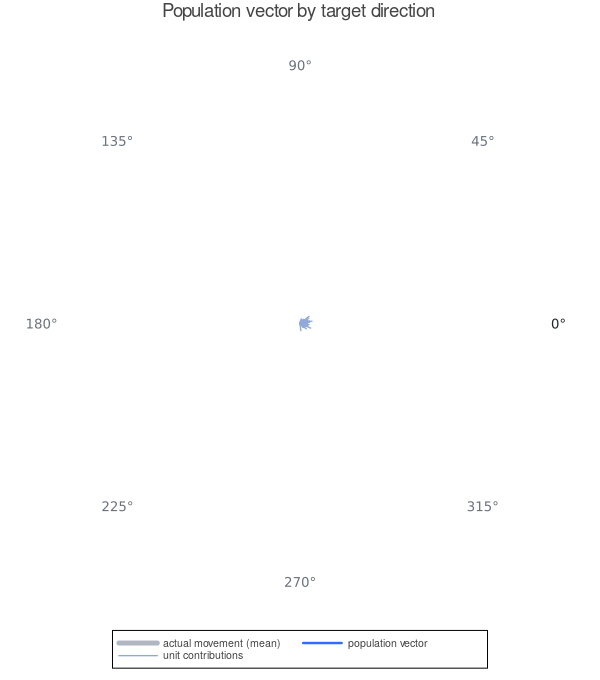
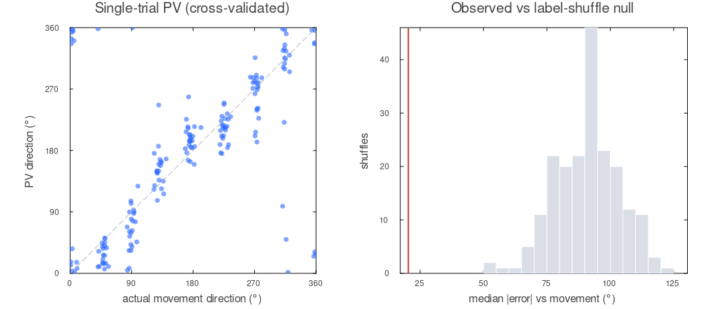
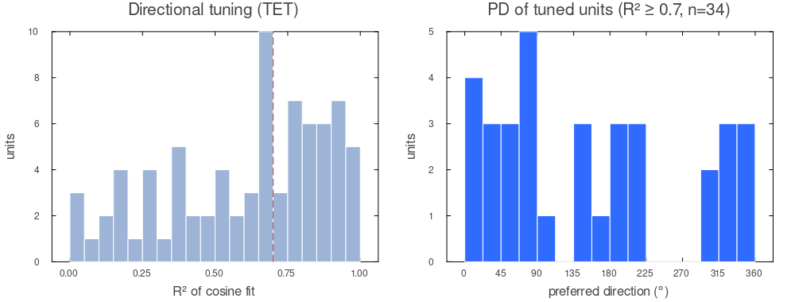
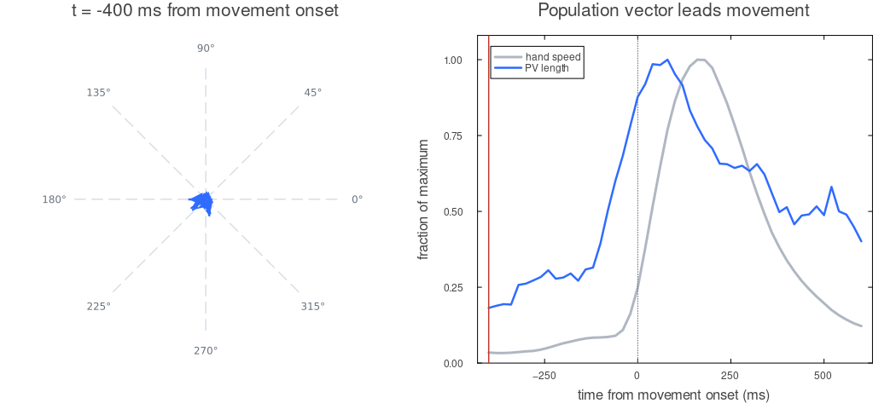
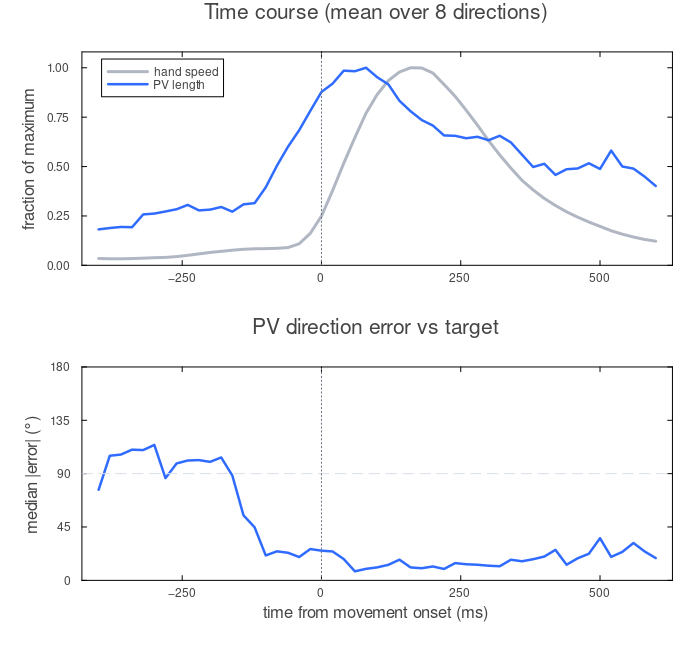

# Population-vector decoding of reach direction in M1

**English** · [한국어](README.ko.md)

Directional tuning and population-vector decoding (Georgopoulos et al., 1982,
1986) applied to the public center-out reaching data of Flint et al. (2012).
Written in Julia as a study project.



For each target, thin lines are the contributions of tuned units (weight × PD).
Their sum is the population vector (blue), shown next to the mean actual
movement (grey). Population vectors are from held-out trials.

## Data

The data come from Flint et al. (2012) and are distributed through the DREAM
database (Walker & Kording, 2013) on CRCNS:
<https://crcns.org/data-sets/movements/dream>.

Download `Flint_2012_e1.mat` from the Flint 2012 data set and put it in
`data/`. The data file is not included here.

- Spikes were recorded with a 96-channel intracortical array in the arm area of
  primary motor cortex (M1). PMd was recorded only as epidural field
  potentials in the original study and is not used here.
- Center-out reaching to 8 targets: 194 trials, 175 labeled `good`.
- 82 unit items with sort codes 1–3 are used as candidate units.

## How to run

Julia 1.10 or later.

```bash
julia --project=. -e 'using Pkg; Pkg.instantiate()'
julia --project=. scripts/01_single_unit_tuning.jl
julia --project=. scripts/02_population_vector.jl data/Flint_2012_e1.mat tet
julia --project=. scripts/02_population_vector.jl data/Flint_2012_e1.mat mt
julia --project=. scripts/03_time_resolved_pv.jl
julia --project=. -e 'using Pkg; Pkg.test()'
```

| Script | What it does | Output |
| --- | --- | --- |
| `01_single_unit_tuning.jl` | Tuning curve, raster and PSTH for one unit (unit 3 by default) | `outputs/single_unit/` |
| `02_population_vector.jl` | Tuning of all units, cross-validated population vector, shuffle test, animation | `outputs/population_vector/` |
| `03_time_resolved_pv.jl` | Population vector in a sliding window around movement onset | `outputs/time_resolved/` |

## Method

1. **Events.** Target onset comes from `TargetPos`. Movement onset and end are
   where hand velocity toward the target stays above / below 0.05 for 5
   samples. Georgopoulos et al. did not give a numeric threshold, so this
   value is a choice.
2. **Firing rates.** Spike count divided by epoch length, for RT (target onset
   to movement onset), MT (movement onset to end), and TET (target onset to
   movement end).
3. **Tuning.** Rates are averaged per target direction, then fitted with
   `y = b0 + b1 sin θ + b2 cos θ`.
   Preferred direction `PD = atan2(b1, b2)`, amplitude `√(b1² + b2²)`.
4. **Population vector.** Units with R² ≥ 0.7 each add a vector along their PD
   with weight `(r − b0) / amplitude`.
   - Direction-averaged PV: test-trial rates are averaged per direction first
     (the original form).
   - Single-trial PV: each test trial is decoded on its own.
5. **Validation.** 5-fold cross-validation, stratified by direction. Tuning and
   unit selection use only the training folds. Decoded directions are compared
   with the target direction and with the actual hand displacement (movement
   onset to end). For a null model, direction labels in the training folds are
   shuffled 200 times.

## Results

| Epoch | PV | Median error vs target | Median error vs actual movement | 8-way correct |
| --- | --- | --- | --- | --- |
| TET | direction-averaged | 11.9° | 14.9° | – |
| TET | single trial | 16.8° | 20.3° | 58.9% |
| MT | direction-averaged | 10.8° | 11.5° | – |
| MT | single trial | 14.8° | 15.8° | 66.3% |

- 34 of 82 units are tuned in TET (R² ≥ 0.7). Unit 3, for example, has PD 67.6°
  and R² 0.94.
- With shuffled labels, the median error is about 90° and 8-way accuracy is
  12.5%, i.e. chance. The observed error was smaller than in all 200 shuffles
  (p = 0.005, the smallest value 200 shuffles can give).




### Time course

The population vector can also be computed in a 100 ms window that slides in
20 ms steps around movement onset (tuning from training folds, vectors from
held-out trials, as above).



- The population vector grows **before** the hand moves. Its length reaches
  half of its range at −60 ms, while hand speed does so at +40 ms: a lead of
  about 100 ms.
- Its direction is already close to the target before movement onset (median
  error 21° at −100 ms, 12° at +200 ms), while 300 ms before onset it is
  unrelated to the target (114°).
- Windows are centred, so a value at −60 ms uses spikes from −110 to −10 ms.



### Limitations

- Few tuned units prefer 225°–315°, so the vectors for the 270° and 315°
  targets lean toward their neighbors. This is a known weakness of the
  population vector when PDs are not uniform; the optimal linear estimator
  (Salinas & Abbott, 1994) corrects for it.
- One session (`e1`) only.
- Sort codes 1–3 are read as sorted units; the file does not guarantee that
  each is a single neuron.

## Code layout

```text
src/
  DREAMReach.jl          module entry point
  session.jl             load the MAT file; trials, targets, spikes
  events.jl              target onset, movement onset and end
  tuning.jl              epoch firing rates, cosine fit
  perievent.jl           movement-aligned raster / PSTH data
  population_vector.jl   cross-validated population vector, also over time
  plotting.jl            figures
scripts/                 analysis entry points (run in order)
test/runtests.jl         tests on data structure, events, tuning, decoding
outputs/                 generated figures and tables
```

## References

- Georgopoulos, A. P., Kalaska, J. F., Caminiti, R., & Massey, J. T. (1982).
  On the relations between the direction of two-dimensional arm movements and
  cell discharge in primate motor cortex. *Journal of Neuroscience*, 2(11), 1527–1537.
- Georgopoulos, A. P., Schwartz, A. B., & Kettner, R. E. (1986). Neuronal
  population coding of movement direction. *Science*, 233(4771), 1416–1419.
- Flint, R. D., Lindberg, E. W., Jordan, L. R., Miller, L. E., & Slutzky, M. W.
  (2012). Accurate decoding of reaching movements from field potentials in the
  absence of spikes. *Journal of Neural Engineering*, 9(4), 046006.
- Walker, B., & Kording, K. (2013). The Database for Reaching Experiments and
  Models. *PLoS ONE*, 8(11), e78747.
- Salinas, E., & Abbott, L. F. (1994). Vector reconstruction from firing rates.
  *Journal of Computational Neuroscience*, 1(1–2), 89–107.

Junho Heo, Brain–AI Interface Lab, Baekseok University
